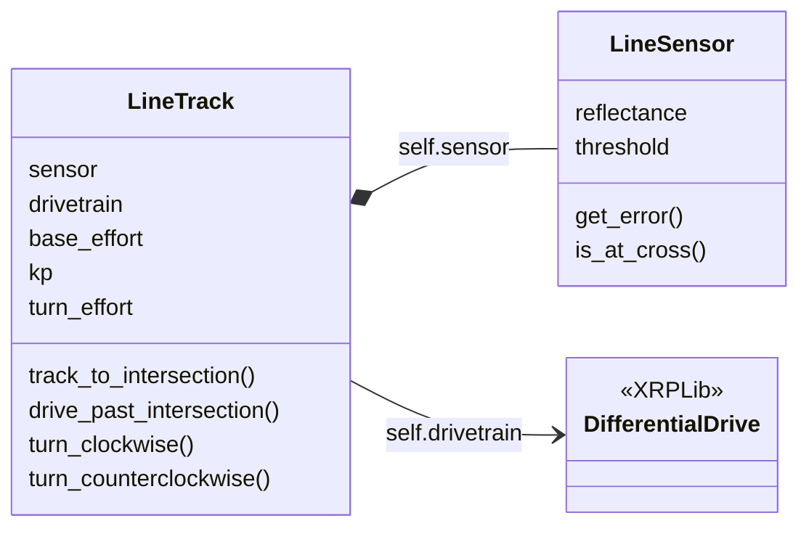

<LessonHeader
  eyebrow="Module 2 · Line Tracking"
  title="Lesson 2-9 · Line-Tracking Functions"
  meta={['60 min', 'Functions built on functions', 'Sensor-ended turns', 'Test as you write']}
/>

<TeacherBanner>
Teacher mode is on. Toggle it off (bottom-right) to preview the student view.
</TeacherBanner>

Last lesson the robot followed the line to a cross and stopped. This lesson finishes
the driving toolkit: three more functions that park the wheels on the intersection and
turn until a sensor finds the next line, built on the five sensor functions from Lesson
2-7 and written one at a time, each tested before the next. With
`track_to_intersection()` from Lesson 2-8, that's four driving functions — and they
drive every robot program for the rest of the course, so the names you learn today are
the ones you'll be using in Module 5.

<Objectives>

By the end of this lesson you will be able to:

- Say what ends each of the four driving functions, and why none of them is a timer
- Explain why the robot drives a fixed distance after the sensors reach a cross, and write `drive_past_intersection()`
- Write `turn_clockwise()` and `turn_counterclockwise()` as *sensor-ended* turns: a blind start, then spin until `is_either_on_line()`
- Drive a follow, turn, follow course with four function calls, from a test function in your one file

</Objectives>

<QuizLink id="module-02-line-tracking/lesson-09-line-tracking-functions" />

## This lesson's skeleton

Paste this into `robot.py` above `RUN`, at the end of the LINE TRACKING section. It
finishes that section: one setting, three function outlines, and the tests for them.

```python
# --- Lesson 2-9: park on the cross, turn to the next line ---
# Completes the driving toolkit begun in Lesson 2-5.
# track_to_intersection() stops with the SENSORS on the cross;
# drive_past_intersection() moves the WHEELS onto it. The two
# turns spin until a LINE SENSOR function sees the next line,
# so no turn depends on a timer. With these four, every
# program from here to Module 5 is a list of calls to this
# section.
TURN_EFFORT = 0.25       # spin speed during a turn

def drive_past_intersection():
    # drive straight forward by exactly the sensor-to-axle
    # distance
    pass

def turn_clockwise():
    # 1. blind turn, about 60 deg: get BOTH sensors off this line
    # 2. keep spinning in place (no forward speed, only turn)
    # 3. wait until a sensor sees the cross street
    # 4. stop
    pass

def turn_counterclockwise():
    # the mirror image: same four moves, opposite direction
    pass

def test_park():
    # follow to the cross, then put the wheels on it
    track_to_intersection()
    drive_past_intersection()

def test_turn():
    # park on the cross, then turn to the cross street
    track_to_intersection()
    drive_past_intersection()
    turn_clockwise()

def test_course():
    # follow, park, turn, follow: the whole lesson in four
    # calls
    track_to_intersection()
    drive_past_intersection()
    turn_clockwise()
    track_to_intersection()
    print("Done!")
```

One more change, in the LINE TRACKING settings: raise `BASE_EFFORT` to **0.4**. Now that the
steering is tuned the robot can go a little faster; if yours weaves at 0.4, drop it
back.

## Four functions, and what ends each one

The driving toolkit is four functions. You have one; you're going to write three
more. For each, this page tells you what it does, what makes it *stop*, and the
skeleton's outline says how — the design is the lesson; the typing is yours.

### The one you have: following the line

`track_to_intersection()` is the control loop with `is_at_cross()` as the exit
condition — *until you're at a cross, steer toward the line; then stop.* All the sensor
arithmetic is behind `get_error()` and `is_at_cross()`, and nothing in the function
reads the hardware directly. It ends on a **cross**. Keep that pattern in mind: the
next three each end on something the robot can *sense*.

### The wrinkle: the sensors get there first

When `track_to_intersection()` stops, both sensors are over the cross. But the
sensors are under the rangefinder at the very front, and the robot turns about its
**center of rotation** — the hole between the two drive wheels where a pen goes, 8.75 cm
further back.

<Figure
  src="/img/lesson-m2-09/park-on-cross-turns.svg"
  alt="Animation of two XRP robots seen from above, each stopped with its line sensors on a taped cross and its center of rotation 8.75 cm behind them. Left: the robot turns right straight away, swinging about a point short of the intersection, and its sensors end up beside the cross street, off the tape. Right: the robot first drives forward 8.75 cm so its center of rotation is on the cross, then turns right, and its sensors land on the cross street."
  caption="Both robots stopped where track_to_intersection() left them. The left one turns right away and swings about a point short of the cross; the right one drives 8.75 cm first, so it spins on the cross and its sensors find the new line."
/>

So after every track, `drive_past_intersection()` drives forward that 8.75 cm: the
center of rotation ends up where the sensors were. It does a second job too — it carries the
sensors past the cross, so the next `track_to_intersection()` doesn't see the same tape
and stop instantly.

It's a distance, not a `time.sleep()`, on purpose. Eight and three-quarter centimeters
is the same with a full battery or a flat one; half a second is not. You know the
drivetrain call that drives a distance — you've used it since Lesson 1-8.

<KnowledgeCheck
  question="Why does drive_past_intersection() use a distance rather than driving for half a second?"
  options={[
    {text: 'straight() is easier to spell'},
    {text: 'A distance is the same with a full or flat battery and on any floor; a time would have to be re-tuned constantly', correct: true},
    {text: 'time.sleep() cannot be used with motors'},
    {text: 'Because 8.75 is a magic number'},
  ]}
  explanation="The course avoids timing-based movement everywhere. Distances and sensor readings describe the world; a duration describes a guess about the motors."
/>

### Turning until a sensor says stop

How far is a 90° turn? You could time it — and it would be right until the battery
dropped. Instead, turn until the sensors *find the next line*. That's the four moves in the
skeleton's outline of `turn_clockwise()`, and `turn_counterclockwise()` is its mirror
image.

<Figure
  src="/img/lesson-m2-09/sensor-ended-turn.svg"
  alt="Four top-down drawings of the XRP parked on an intersection, turning right onto the cross street. 1, blind turn of about 60 degrees: both line sensors are now off the line it was following. 2, keep spinning in place: the motors stay on while the program goes on. 3, wait until a sensor sees the line: the leading sensor reaches the cross street and is_either_on_line() becomes True. 4, stop, facing the new line, ready to follow it. Below, two mistakes: a blind turn that is too small (10 degrees) leaves a sensor on the old line, so the wait ends at once; one that is too big (120 degrees) swings the sensors past the cross street, so the robot keeps spinning."
  caption="The four moves of turn_clockwise(). The blind turn clears the old line; a sensor, not a clock, ends the turn."
/>

The blind turn is there because the robot starts the turn with its sensors *on* the
line it was following: without it, `is_either_on_line()` is already `True` and the wait
ends before the robot has moved. Step 2 is `arcade()` with no forward speed, only a turn
value.

That waiting loop has nothing to *do* on each pass — the motors are already running
from the line above; the loop's only job is to keep checking the sensor. Python needs
*something* in a loop body, so you write `pass`: the same word as in the outlines, with
the same meaning, nothing to do here.

Why 60° and not 90°? Because the sensor finishes the turn, the blind part only has to
clear the old line — not so little that a sensor is still on it, not so much that the
sensors swing past the new one (the bottom row of the figure). The two functions are
mirror images: swap the sign on both the blind turn and the spin, and the direction swaps.

<KnowledgeCheck
  question="Why does turn_clockwise() start with a blind 60-degree turn before the while loop?"
  options={[
    {text: 'To make the turn faster'},
    {text: 'Both sensors are still on the line it was following; without moving off it first, is_either_on_line() is already True and the loop ends before the turn starts', correct: true},
    {text: 'Because 60 + 30 = 90'},
    {text: 'To recharge the battery'},
  ]}
  explanation="The sensor-ended loop needs a moment when neither sensor is on tape. The blind turn provides it; the loop then finishes the turn on the next line it finds."
/>

<KnowledgeCheck
  question="What does pass do inside the while loop?"
  options={[
    {text: 'Skips the turn'},
    {text: 'Nothing — it is a placeholder; the loop just keeps re-checking is_either_on_line() while the motors run', correct: true},
    {text: 'Pauses the program'},
    {text: 'Passes the robot to the next line'},
  ]}
  explanation="pass is a do-nothing statement. The motors were already told to spin; the loop's body has nothing to add, and Python needs something there."
/>

<TeacherNote title="Sensors end turns; timers don't">

This is the lesson where the course's rule about timing becomes a habit: nothing
here stops because a clock ran out. `track_to_intersection()` stops on a cross,
`drive_past_intersection()` on a distance, and the turns on a sensor. Say the rule out
loud: *timing is never good for programs like this; sensors always work.*

The build-and-test-in-order sequence is the student activity below, one function
per step, so expect the class to spread out: some pairs will be tuning a turn while
others are still watching the first follow. That's fine — nothing in step 3 depends on
a neighbor's step 2. The 8.75 cm is sensor-to-axle on an XRP; measure it if the
robot's mounting differs.

The cross line must be clearly perpendicular to the circle, or `is_at_cross()` fires
unreliably and the turn finds the new line at an angle.

</TeacherNote>

## Activity · Build the toolkit, one function at a time

The skeleton is pasted in and `BASE_EFFORT` is 0.4. For every step the robot starts
on the circle-with-cross, pointed along the circle, and the run block waits for the
button.

### Step 1 · track_to_intersection(), at the new speed

Nothing to write — but the speed went up, so set the run call to `test_track()` and
run it once more. It should follow the line and stop with both sensors on the cross.
If it weaves at the new speed, drop `BASE_EFFORT` back to 0.3. Don't go on until the
function you're building on works.

### Step 2 · drive_past_intersection()

Write the body — one line — and run `test_park()`. The robot should end with its
*wheels* on the cross. Put a finger on the tape beside the robot and check: the axle
should sit over the line, and the sensors should be past it.

### Step 3 · turn_clockwise()

Write the four moves, with `TURN_EFFORT` at 0.25 to start, and run `test_turn()`.
Watch the two halves — the blind part should carry both sensors clear of the circle,
and then the spin should stop the moment a sensor meets the cross street. Two things
to tune if it doesn't:

- **The turn stops at once, barely moving.** The blind part was too small — a sensor
  was still on the old line when the loop started. Increase the 60°.
- **The robot spins past the cross street and keeps going.** The blind part was too
  big — it carried the sensors past the new line. Decrease it.

### Step 4 · turn_counterclockwise()

Mirror step 3: same four moves, both signs flipped. Change `test_turn()` to call it
instead, run it from the cross, and confirm it finds the cross street on the *other*
side.

### Step 5 · Four lines to drive a course

With all four working, run `test_course()`. Look at it: the part of the program that
actually *drives* is four calls. All the sensor reading and motor control lives in the
sections above it, so the test reads as a list of intentions. Compare it to the wall of
code this was back in Lesson 2-6.

**Challenge:** add `turn_around()` to the section — it calls `turn_clockwise()` twice
— and a `test_turn_around()` for it. Does the second call need a blind turn? (Yes —
after the first, a sensor is on the new line.)

<Reveal title="Check your three new functions" hint="write and test all three first">

```python
def drive_past_intersection():
    drivetrain.straight(8.75, 0.5)

def turn_clockwise():
    drivetrain.turn(-60, TURN_EFFORT)      # 1. blind: clear this line
    drivetrain.arcade(0, -TURN_EFFORT)     # 2. keep spinning...
    while not is_either_on_line():
        pass                               # 3. ...until a sensor sees a line
    drivetrain.stop()                      # 4.

def turn_counterclockwise():
    drivetrain.turn(60, TURN_EFFORT)
    drivetrain.arcade(0, TURN_EFFORT)
    while not is_either_on_line():
        pass
    drivetrain.stop()
```

If yours differs and still works, keep yours. If it differs and doesn't, the first
things to compare are the two signs in each turn.

</Reveal>

<KnowledgeCheck
  question="In the four-line program, why is drive_past_intersection() called between track_to_intersection() and turn_clockwise()?"
  options={[
    {text: 'To give the motors a rest'},
    {text: 'So the wheels are over the cross when the turn pivots, and the sensors are clear of it', correct: true},
    {text: 'It is optional; the turn works the same without it'},
    {text: 'To reset the error to zero'},
  ]}
  explanation="The sensors reached the cross first. drive_past_intersection() moves the wheels onto it, so the turn pivots on the intersection and the next track does not start on the same tape."
/>

<TeacherNote title="Differentiation">

**More support:** give the finished sensor toolkit and have students write only the
driving functions, starting with `drive_past_intersection()`. **More challenge:** a
timeout so a turn that never finds a line gives up (count loop passes, not seconds), or
a `track_for_distance()` using the drivetrain's encoders rather than a timer.

</TeacherNote>

<TeacherNote title="Solution (teacher copy)">

This lesson's addition to the LINE TRACKING section of `robot.py`, with the
challenge; the rest of the file is as the Lesson 2-8 teacher copy left it apart from
`BASE_EFFORT = 0.4`. The file is `lesson-09-line-tracking-functions.py` in the Module
2 solutions. Students see only the outlines and the three bodies behind the "Check
your three new functions" reveal, which is closed by default and not printed.

```python
# --- Lesson 2-9: park on the cross, turn to the next line ---
# Completes the driving toolkit begun in Lesson 2-5.
# track_to_intersection() stops with the SENSORS on the cross;
# drive_past_intersection() moves the WHEELS onto it. The two
# turns spin until a LINE SENSOR function sees the next line,
# so no turn depends on a timer. With these four, every
# program from here to Module 5 is a list of calls to this
# section.
TURN_EFFORT = 0.25

def drive_past_intersection():
    drivetrain.straight(8.75, 0.5)

def turn_clockwise():
    drivetrain.turn(-60, TURN_EFFORT)
    drivetrain.arcade(0, -TURN_EFFORT)
    while not is_either_on_line():
        pass
    drivetrain.stop()

def turn_counterclockwise():
    drivetrain.turn(60, TURN_EFFORT)
    drivetrain.arcade(0, TURN_EFFORT)
    while not is_either_on_line():
        pass
    drivetrain.stop()

def turn_around():
    turn_clockwise()
    turn_clockwise()

def test_park():
    track_to_intersection()
    drive_past_intersection()

def test_turn():
    track_to_intersection()
    drive_past_intersection()
    turn_clockwise()

def test_course():
    track_to_intersection()
    drive_past_intersection()
    turn_clockwise()
    track_to_intersection()
    print("Done!")

def test_turn_around():
    track_to_intersection()
    drive_past_intersection()
    turn_around()
    track_to_intersection()
    print("Done!")

# ===== RUN =====
board.wait_for_button()
test_course()
```

</TeacherNote>

## Real-world connections

Layered toolkits are how robot software is organized:

<CardGrid>
  <InfoCard tag="Robots" title="Skill stacks">
    Perception functions feed motion functions feed planning functions — each layer built on the one below, as the driving toolkit is built on the sensor toolkit.
  </InfoCard>
  <InfoCard tag="Cars" title="Sensor-ended actions">
    Parking assist stops when the sensors say the space is reached, not after a set number of seconds.
  </InfoCard>
  <InfoCard tag="Software" title="Libraries on libraries">
    Almost every library you will use is built on another one, calling its functions rather than re-reading the hardware.
  </InfoCard>
</CardGrid>

## Wrap-up

- What ends each of the four driving functions? (A cross, a distance, a line, a line.)
- Why `drive_past_intersection()` after every track? (The sensors reach the cross before the wheels do.)
- Why the blind 60° at the start of a turn? (To get the sensors off the old line so the loop can end on the new one.)

<TeacherNote title="Assessment & next lesson">

**Formative:** trace `track_to_intersection()`; explain the blind turn and `pass`; say
what ends each function. **Exit ticket:** "Write `track_and_turn_clockwise()` that
follows to a cross, parks on it, and turns." **Preview:** the final project uses the
driving toolkit to lap the circle, reversing at the cross, and stop.

</TeacherNote>

<OptionalExtension title="The LineTrack class: one object holding another">

If you built the `LineSensor` class in Lesson 2-7, the driving toolkit can become a
class too — and this one shows something new: a class that **contains** another. A car
*has an* engine. `LineTrack` **has a** `LineSensor` for sensing and **has a** drivetrain
for driving, and coordinates them. One object holding another is called
**composition**.

This is the class-track skeleton for the whole LINE TRACKING section. Paste it in
place of the section's settings and four functions (keep the test functions), and
move your four bodies into the four methods.

```python
# ===== LINE TRACKING (class version) =====
# One LineTrack object drives the robot along the line. It HAS
# A LineSensor (built in __init__, so you never make one
# separately) and asks it the questions; it HAS the drivetrain
# and gives it the orders. Same four methods as the function
# version, same names, with tracker. in front.
class LineTrack:
    def __init__(self):
        self.sensor = LineSensor()           # has-a LineSensor
        self.drivetrain = DifferentialDrive.get_default_differential_drive()
        self.base_effort = 0.4
        self.kp = 0.5
        self.turn_effort = 0.25

    def track_to_intersection(self):
        # your function, with self. in front of the sensor,
        # the drivetrain and the settings
        pass

    def drive_past_intersection(self):
        pass

    def turn_clockwise(self):
        pass

    def turn_counterclockwise(self):
        pass

tracker = LineTrack()
```

`__init__` is the new idea, so it's given: the object builds its own `LineSensor` and
keeps the three settings as attributes. The four methods are *your* four functions —
move each body in, then put `self.` in front of every sensor call, every drivetrain
call and every setting. Where a function said `get_error()`, the method says
`self.sensor.get_error()`; where it said `KP`, the method says `self.kp`. That
translation, done four times, is the whole extension. Your test functions stay where
they are; each call in them gets `tracker.` in front, and `test_course()` is the check
that nothing else changed.

<Reveal title="Check your LineTrack" hint="translate all four methods first">

```python
    def track_to_intersection(self):
        while not self.sensor.is_at_cross():
            error = self.sensor.get_error()
            correction = error * self.kp
            self.drivetrain.arcade(self.base_effort, -correction)
        self.drivetrain.stop()

    def drive_past_intersection(self):
        self.drivetrain.straight(8.75, 0.5)

    def turn_clockwise(self):
        self.drivetrain.turn(-60, self.turn_effort)
        self.drivetrain.arcade(0, -self.turn_effort)
        while not self.sensor.is_either_on_line():
            pass
        self.drivetrain.stop()

    def turn_counterclockwise(self):
        self.drivetrain.turn(60, self.turn_effort)
        self.drivetrain.arcade(0, self.turn_effort)
        while not self.sensor.is_either_on_line():
            pass
        self.drivetrain.stop()
```

</Reveal>

<SideBySide>
<div>

```python
track_to_intersection()
drive_past_intersection()
turn_clockwise()
track_to_intersection()
```

</div>
<div>

```python
tracker = LineTrack()

tracker.track_to_intersection()
tracker.drive_past_intersection()
tracker.turn_clockwise()
tracker.track_to_intersection()
```

</div>
</SideBySide>

When you create a `LineTrack`, it builds its *own* `LineSensor` inside `__init__` —
you don't make one separately — and asks it questions with `self.sensor.get_error()`
and `self.sensor.is_at_cross()`. The functions are the same four, with the same names;
the settings moved from file-level capitals into `self.` attributes. The file is
`lesson-09-linetrack-class-addon.py` in the Module 2 solutions. One thing to notice
about your file now: the LINE SENSOR section has a class and no `sensor = LineSensor()`
line is needed any more — `LineTrack` makes the one it uses. Keep yours for
`test_sensors()`, or delete it; either is fine.

The filled diamond is how a class diagram draws **has a**: the diamond sits on the side of the owner. `LineTrack` builds its `LineSensor` and keeps it; the drivetrain comes from XRPLib, so it is drawn as a plain arrow.



**From here on, use your class.** You now have the whole Module 2 toolkit as objects,
and the point of building it that way is lost if it sits in a drawer. The lessons ahead
are written with the function names, because that is what every student has — and
yours are the same names with `tracker.` in front. When Lesson 3-1 says
`track_to_intersection()`, you write `tracker.track_to_intersection()`. Nothing else
changes, and the lessons that offer a class extension will meet you with the next
object to build on this one.

</OptionalExtension>

## Resources

- [XRPLib Documentation](https://open-stem.github.io/XRP_MicroPython/)
- [XRP Robot User Guide](https://xrpusersguide.readthedocs.io/)
