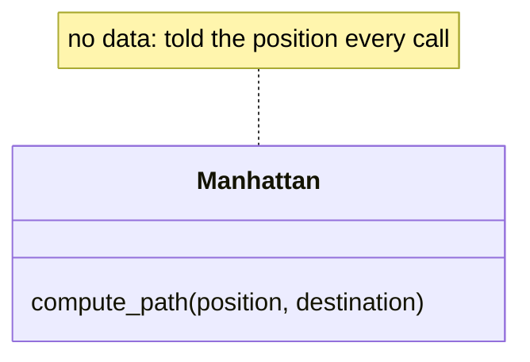

<LessonHeader
  eyebrow="Module 4 · Manhattan Navigation"
  title="Lesson 4-5 · A Reusable Planner Function"
  meta={['50 min', 'Functions as contracts', 'Docstrings']}
/>

<TeacherBanner>
Teacher mode is on. Toggle it off (bottom-right) to preview the student view.
</TeacherBanner>

Last lesson you wrote `compute_path()` and it worked. This lesson doesn't change a single
line inside it. Instead you'll give it its real name, write down exactly what it promises,
and settle one design rule that the rest of the course depends on: **the planner is told
where the robot is. It never remembers.** Small lesson, big consequences — Module 5 swaps
in a completely different planner behind this same function shape, and nothing else has
to change.

<Objectives>

By the end of this lesson you will be able to:

- Rename `compute_path()` to `compute_manhattan_path(position, destination)` in `robot.py`, update every call to it, and say why each part of the name matters
- State the function's three promises: the path never includes the start, it ends at the destination, and it is `[]` when you are already there
- Write a docstring that records those promises
- Explain why the planner takes the robot's position as a parameter instead of storing it
- Write a paper test that calls the planner from several different positions, and check each result by hand

</Objectives>

<QuizLink id="module-04-manhattan/lesson-05-manhattan-function" />

## A rename with a reason

Here is the whole change to the function's first line, in the MANHATTAN PLANNER
section of `robot.py`:

```python
# Lesson 4-4
def compute_path(start, end):

# Lesson 4-5
def compute_manhattan_path(position, destination):
```

Three words changed, each on purpose. (Nothing is pasted in this lesson — it's an
edit to a function you already have, the same way Lesson 2-6 rewrote `get_error()`.)

**`manhattan`** says *which* algorithm this is. Right now it's the only planner you have,
so the name feels redundant. In Module 5 you'll write a second one, `compute_bfs_path()`,
that finds routes around obstacles — and the two need to sit in the same file without
colliding.

**`position`**, not `start`, says what the argument *is*: where the robot is right now.
A path isn't always planned from the robot's starting corner. After the robot drives to
(2, 3), the next path is planned from (2, 3).

**`destination`**, not `end`, because `end` is a vague word and a worse one next to
`start`. The path ends at the destination; the robot ends there too.

<KnowledgeCheck
  question="Why does the function's name include 'manhattan' when it is the only planner in the course so far?"
  options={[
    {text: 'Python requires function names to have three parts'},
    {text: 'Module 5 adds a second planner, compute_bfs_path(), and both need to exist in the same program without colliding', correct: true},
    {text: 'Because it is faster to type'},
    {text: 'It is a convention for while loops'},
  ]}
  explanation="A name that says which algorithm it is costs nothing now and saves a rename later. compute_manhattan_path() and compute_bfs_path() will sit side by side in Module 5."
/>

## What the function promises

A function is a kind of contract: give me these inputs, and I guarantee this output. Write
the guarantee down, right under the `def` line, in a **docstring** — a string in triple
quotes that Python keeps attached to the function:

```python
def compute_manhattan_path(position, destination):
    """Compute a Manhattan path from position to destination.

    position:    a (row, col) tuple -- where the robot is now
    destination: a (row, col) tuple -- where it needs to go

    Returns a list of (row, col) tuples the robot should move to,
    not including position itself.
    """
    path = []
    ...
```

That last sentence is the one people get wrong, so check it against the code. The first
thing appended to `path` is the position *after* the first step, never `position` itself.
So the function promises three things:

1. The path **never includes the start.** `compute_manhattan_path((0, 0), (2, 0))` is
   `[(1, 0), (2, 0)]`, not `[(0, 0), (1, 0), (2, 0)]`.
2. The path **ends at the destination** — the last element is always `destination`.
3. If you're already there, the path is **empty**: `compute_manhattan_path((1, 1), (1, 1))`
   returns `[]`, because every `while` loop is skipped.

Why does promise 1 matter? Because the robot is going to drive this list. Each element is
an intersection to drive *to*. The robot is already standing on `position`; telling it to
drive there would mean driving zero distance and getting confused about which way to turn.
Every planner in this course — Manhattan now, BFS and Dijkstra later — makes the same
three promises.

<KnowledgeCheck
  question="What does compute_manhattan_path((2, 1), (2, 1)) return, and why?"
  options={[
    {text: '[(2, 1)] — the destination is always included'},
    {text: '[] — the robot is already there, so every while loop condition is false and nothing is appended', correct: true},
    {text: 'An error, because position equals destination'},
    {text: '[(2, 1), (2, 1)]'},
  ]}
  explanation="Promise 3. With current_row == dest_row and current_col == dest_col, none of the four loops run, and path stays empty. That is the right answer: there is nowhere to go."
/>

<KnowledgeCheck
  question="A classmate's version returns [(0, 0), (1, 0), (2, 0)] for position (0, 0), destination (2, 0). Which promise did it break, and why does it matter?"
  options={[
    {text: 'Promise 2 — the path does not end at the destination'},
    {text: 'Promise 1 — the path includes the start, so the robot would be told to drive to the intersection it is already standing on', correct: true},
    {text: 'Promise 3 — the path should be empty'},
    {text: 'No promise was broken; this is also correct'},
  ]}
  explanation="The path is a list of places to drive TO. The robot is already at (0, 0); listing it as a step gives the driving code a zero-length move and a turn it cannot work out."
/>

## The planner is told, it doesn't remember

Here's the design rule. Look at how the same function is used three times in a row:

```python
path1 = compute_manhattan_path((0, 0), (2, 3))     # plan from the corner
path2 = compute_manhattan_path((2, 3), (0, 3))     # robot drove there; plan from there
path3 = compute_manhattan_path((0, 3), (0, 0))     # and again
```

<Figure
  src="/img/lesson-m4-05/told-not-remembered.svg"
  alt="A 4 by 4 grid with three legs: (0, 0) to (2, 3), then (2, 3) to (0, 3), then (0, 3) back to (0, 0). Beside it the three planner calls with the first argument of each, the robot's current position, highlighted in its leg's color."
  caption="The first argument changes every time, because the robot has moved. The planner never has to know that; it is told."
/>

Every call is handed the robot's position. The planner never stores it. That might look
like extra typing, but it buys something important: **only one piece of code is in charge
of knowing where the robot is** — the driving code, which you'll write in Lesson 4-8.
It updates its `position` variable after every intersection and hands the current value
to the planner whenever it needs a route.

If the planner *also* kept a copy of the position, you'd have two variables that are
supposed to agree. The first time one gets updated and the other doesn't, the robot
plans from a place it isn't. That's a real bug, and the easiest way to never have it is
to never have the second copy.

So: a planner has no memory. It's a pure calculation — tuples in, list out. That's also
exactly why you can test it on any computer with no robot attached, which is next lesson.

<KnowledgeCheck
  question="Why does compute_manhattan_path() take position as a parameter every call, instead of remembering where the robot started?"
  options={[
    {text: 'Functions cannot store values between calls'},
    {text: 'So only the driving code tracks where the robot is — a second copy inside the planner would eventually disagree with the real one', correct: true},
    {text: 'Because the start is always (0, 0)'},
    {text: 'To make the function slower and more careful'},
  ]}
  explanation="One owner for the robot's position. The driving code updates it after every intersection; the planner is handed the current value and does arithmetic with it. No second copy, no disagreement."
/>

## Activity · Call it from everywhere

### Step 1 · The rename

In the MANHATTAN PLANNER section, change the `def` line and replace the one-line
docstring with the full one above. Then set the run line to `test_paper_paths()` and
run it — and read the error. Your Lesson 4-4 tests still call `compute_path()`, which
no longer exists. A rename changes every *call* as well as the definition, which is
exactly why names in this file are chosen carefully and changed almost never. Update
both tests and run them again; same output as yesterday.

### Step 2 · A test from everywhere

Write a new test — `test_from_everywhere()` — with these four calls, each printed.
Before you run it, trace each answer by hand on the grid diagram and write what you
expect as a comment next to the call:

```python
print(compute_manhattan_path((0, 0), (2, 3)))   # south, then east
print(compute_manhattan_path((0, 0), (3, 1)))
print(compute_manhattan_path((3, 3), (1, 0)))   # north, then west
print(compute_manhattan_path((2, 0), (2, 4)))   # same row: east only
```

Set the run line to it. Then check all three promises against each result — no start,
ends at the destination — and add a fifth call where position equals destination.

<Reveal title="Check your four traces" hint="trace all four by hand first">

```
[(1, 0), (2, 0), (2, 1), (2, 2), (2, 3)]
[(1, 0), (2, 0), (3, 0), (3, 1)]
[(2, 3), (1, 3), (1, 2), (1, 1), (1, 0)]
[(2, 1), (2, 2), (2, 3), (2, 4)]
```

And the fifth call prints `[]`, promise 3.

</Reveal>

<TeacherNote title="Solution (teacher copy)">

The MANHATTAN PLANNER section of `robot.py` as this lesson leaves it, plus the run
block; the rest of the file is as the Lesson 4-4 teacher copy left it. The file is
`lesson-05-manhattan-function.py` in the Module 4 solutions. The four `while` loops
are byte-for-byte the Lesson 4-4 ones.

```python
# ===== MANHATTAN PLANNER =====
# Plans a route across the grid: given where the robot is and
# where it should go, returns the list of (row, col) tuples to
# drive to, rows first and then columns. Pure arithmetic --
# nothing in here touches a sensor or a motor, so every test
# in this section runs on screen with the robot sitting still.

def compute_manhattan_path(position, destination):
    """Compute a Manhattan path from position to destination.

    position:    a (row, col) tuple -- where the robot is now
    destination: a (row, col) tuple -- where it needs to go

    Returns a list of (row, col) tuples the robot should move to,
    not including position itself.
    """
    path = []
    current_row, current_col = position
    dest_row, dest_col = destination

    while current_row < dest_row:
        current_row = current_row + 1
        path.append((current_row, current_col))

    while current_row > dest_row:
        current_row = current_row - 1
        path.append((current_row, current_col))

    while current_col < dest_col:
        current_col = current_col + 1
        path.append((current_row, current_col))

    while current_col > dest_col:
        current_col = current_col - 1
        path.append((current_row, current_col))

    return path

def test_paper_paths():
    print(compute_manhattan_path((0, 0), (2, 3)))
    print(compute_manhattan_path((1, 1), (3, 4)))
    print(compute_manhattan_path((3, 3), (1, 0)))

def test_edge_cases():
    print(compute_manhattan_path((2, 0), (2, 3)))
    print(compute_manhattan_path((0, 2), (3, 2)))
    print(compute_manhattan_path((1, 1), (1, 1)))

def test_from_everywhere():
    print(compute_manhattan_path((0, 0), (2, 3)))   # south, then east
    print(compute_manhattan_path((0, 0), (3, 1)))
    print(compute_manhattan_path((3, 3), (1, 0)))   # north, then west
    print(compute_manhattan_path((2, 0), (2, 4)))   # same row: east only
    print(compute_manhattan_path((2, 2), (2, 2)))   # already there: []

# ===== RUN =====
board.wait_for_button()
test_from_everywhere()
```

</TeacherNote>

<KnowledgeCheck
  question={'A classmate runs compute_manhattan_path((3, 3), (1, 0)) and gets [(3, 3), (2, 3), (1, 2), (1, 1), (1, 0)]. What went wrong?'}
  options={[
    {text: 'Nothing — that is a valid Manhattan path'},
    {text: 'The north loop appends before it subtracts 1 from current_row, so the start is included and (1, 3) is skipped — promise 1 is broken', correct: true},
    {text: 'The destination tuple is backwards'},
    {text: 'The west loop ran before the north loop'},
  ]}
  explanation="Swapping the two lines inside a loop (append first, then change the row) shifts every entry of that leg by one: the start appears and the corner is missed. Promise 1 is the quickest way to spot it: the first element should never equal position."
/>

<TeacherNote title="A small lesson on purpose — spend the time on the three promises">

Students own the algorithm from 4-4; keep the load on the contract. The one that bites
later is promise 1: in Lesson 4-8 the driving loop is `for next_pos in path`, and a path
that includes the start makes the first `desired_heading()` call see a zero move and
return `None`. Have students write the promise in the docstring *and* say it out loud.

The "told, not remembered" rule is Module 5's foundation, so give it the full ten
minutes. The bug it prevents is concrete: in the old class version of this lesson, the
planner stored `self.position` and the driving code stored its own — and every student
program needed a line to keep them in sync. Nobody misses that line.

Docstrings are new. Show that `help(compute_manhattan_path)` prints it, and that the
first line is a one-sentence summary by convention. Don't go further than that.

The append-before-update bug in the last knowledge check is the one students actually
make; reading their own output against the three promises is the habit 4-6 builds on.

</TeacherNote>

## Real-world connections

A function with a written promise, no memory, and the same shape as its alternatives is
how big systems stay swappable:

<CardGrid>
  <InfoCard tag="Maps" title="Routing engines">
    A map app's router is handed your current location every time you ask; it never assumes you are where you were. Swap in a bike router and the app does not change.
  </InfoCard>
  <InfoCard tag="Software" title="Pure functions">
    Inputs in, output out, nothing stored. Engineers prize these because they are the easiest code to test and the hardest to get subtly wrong.
  </InfoCard>
  <InfoCard tag="Teams" title="Interfaces">
    Write down what a function promises and two people can work on either side of it without talking every hour.
  </InfoCard>
</CardGrid>

## Wrap-up

- Why `compute_manhattan_path` and not `compute_path`? (Module 5 adds `compute_bfs_path`; the name says which.)
- What are the three promises? (No start in the path; ends at the destination; `[]` when already there.)
- Who knows where the robot is? (The driving code, and only it. The planner is told.)

<TeacherNote title="Assessment & next lesson">

**Formative:** state the three promises from memory; explain why the planner takes
`position` rather than storing it; produce output matching the 4-4 hand traces from
three different positions. **Exit ticket:** "Your partner's planner stores the start
position inside it. Describe one bug that could cause." **Preview:** next lesson tests
this function *systematically*, on screen, with a `run_test()` helper — possible only
because the planner is pure arithmetic.

</TeacherNote>

<OptionalExtension title="The Manhattan class">

If you did the class extensions in Module 2, here is the same planner as a class. Read
the docstring first — it answers the obvious question, which is *why bother*.

This is the class-track skeleton for the MANHATTAN PLANNER section. Paste it in place
of the `compute_manhattan_path()` function (keep your tests), move the four loops into
the method, and the object is created right under the class, as `sensor` and `tracker`
were in Module 2.

```python
# ===== MANHATTAN PLANNER (class version) =====
# One Manhattan object plans routes across the grid, rows
# first and then columns. It holds NO state: compute_path()
# is told the robot's position every call. Pure arithmetic.
class Manhattan:
    """The Lesson 4-5 planner as a class.

    It holds NO state: compute_path() is told the robot's position
    every time. Manhattan is a class only so that it has the same
    shape as the Module 5 and 6 planners (BFS, Dijkstra) -- then one
    main program and one test harness work with any of them by
    changing one name.
    """

    def __init__(self):
        pass        # nothing to set up

    def compute_path(self, position, destination):
        # your compute_manhattan_path(), unchanged: nothing in
        # it needs self., because the planner holds nothing
        pass

planner = Manhattan()
```

Your tests stay where they are; each `compute_manhattan_path(` in them becomes
`planner.compute_path(`. Run `test_from_everywhere()` again: same five lists.

<Reveal title="Check your Manhattan" hint="move the loops in and rerun the tests first">

```python
    def compute_path(self, position, destination):
        path = []
        current_row, current_col = position
        dest_row, dest_col = destination

        while current_row < dest_row:
            current_row = current_row + 1
            path.append((current_row, current_col))

        while current_row > dest_row:
            current_row = current_row - 1
            path.append((current_row, current_col))

        while current_col < dest_col:
            current_col = current_col + 1
            path.append((current_row, current_col))

        while current_col > dest_col:
            current_col = current_col - 1
            path.append((current_row, current_col))

        return path
```

The method body is the function body, indented one level further. That is the whole
translation, and the lack of `self.` inside it is the point of the docstring.

</Reveal>

<SideBySide>
<div>

```python
path = compute_manhattan_path((0, 0), (2, 3))
```

</div>
<div>

```python
planner = Manhattan()
path = planner.compute_path((0, 0), (2, 3))
```

</div>
</SideBySide>

Notice what did *not* happen: `__init__` does not take a start position, and there is
no `self.position`. The rule from this lesson still holds inside a class — the planner
is told where the robot is. The `__init__` is empty because Manhattan has nothing to set
up; BFS in Module 5 will use its `__init__` to hold the list of blocked intersections,
and that's the moment the class earns its keep. The file is
`lesson-05-manhattan-class-addon.py` in the Module 4 solutions.

The class diagram has no middle row at all, which is the point of the paragraph above:



**From here on, use your class.** The lessons ahead are written with the function
name, because that is what every student has; yours is the same call with `planner.`
in front and a shorter name. When Lesson 4-6 says `compute_manhattan_path(position,
destination)`, you write `planner.compute_path(position, destination)` — inside the
test harness, in the final project, everywhere. Nothing else changes.

</OptionalExtension>

## Resources

- [XRPLib Documentation](https://open-stem.github.io/XRP_MicroPython/)
- [Python docstrings](https://peps.python.org/pep-0257/)
