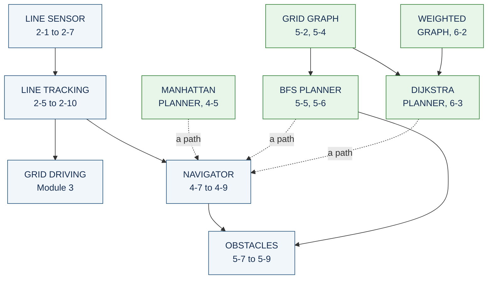
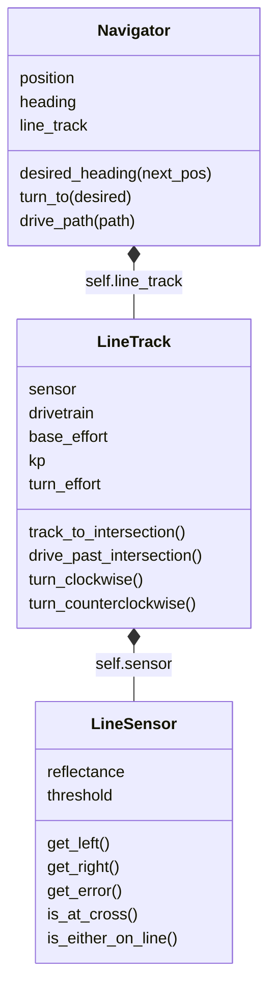
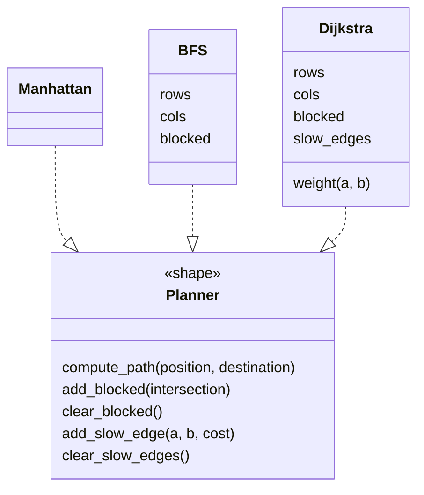

<LessonHeader
  eyebrow="Reference · Modules 2 to 6"
  title="How robot.py fits together"
  meta={['One file, ten sections', 'Functions and classes', 'Diagrams']}
/>

By the end of the course, `robot.py` holds ten sections, written a lesson at a time
from Lesson 2-1 onward. None of them is big. What makes the finished program work is
that each section is built on the ones before it, so a later section never has to do
an earlier section's job again. This page draws that structure twice: once for the
functions everyone writes, and once for the classes in the optional extensions.

## The sections, and what each one uses

Each box is a section of the file, with the lessons that build it. A solid arrow means "is built on": LINE TRACKING calls the LINE SENSOR
functions, NAVIGATOR calls the LINE TRACKING ones, and so on. The green planners never touch the robot. They only work out a list of intersections, which is why
you can test them on paper.

Blue sections move the robot or read its sensors. Green sections only think: give them
a position and a destination and they hand back a path. The dotted arrows are the one
place the two halves meet. `drive_path()` is handed a list of intersections and drives
it, and it never finds out which planner made the list. That is why Module 5 can swap
Manhattan for BFS, and Module 6 can swap in Dijkstra, without changing a line of
driving code.

The last thing in the file is the `RUN` block, which calls one test at a time. It is
not drawn here, because it can call anything above it.

## The classes, if you took the extensions

The optional extensions turn the same sections into objects. The names match the
functions one for one; what changes is that each object keeps its own data instead of
reading file-level settings.

The driving side is a chain of objects, each holding the next:

The planning side is three classes with the same shape:

**How to read it.** Each box is a class: its name, then its data (what `__init__` sets
up), then its methods.

- A **filled diamond** means *has a*, with the diamond on the owner's side. A
  `Navigator` has a `LineTrack`, which has a `LineSensor`, so making one navigator
  builds all three. This is called **composition** (Lesson 2-9).
- A **dotted arrow with a hollow head** means *has the shape of*. `Planner` is not a
  class in your file. It is a name for a list of method names, and every planner
  answers to all of them, even where a method does nothing (`Manhattan.add_blocked()`
  ignores the call). That shared shape is what lets one test harness test all three
  planners (Lessons 5-6 and 6-5).
- `Manhattan` has no data at all. A planner is told where the robot is on every call,
  and only `Navigator` keeps track of position and heading.

## Where the diagrams are in the lessons

Flowcharts, for the loops every student writes:

| Lesson | Flowchart |
|---|---|
| 2-2 | A `while` loop: the condition decides, the body repeats |
| 2-5 | The proportional control loop: read, error, correction, steer |
| 2-8 | `track_to_intersection()`: looking in the condition, following in the body |
| 4-7 | `turn_to()`: turn clockwise until facing the right way |
| 5-5 | Breadth-first search, oldest first |
| 5-7 | Look ahead before each step, and re-plan when something is in the way |
| 6-3 | Dijkstra: the BFS flowchart with its two changes in red |

Class diagrams, inside the optional extensions:

| Lesson | Class diagram |
|---|---|
| 2-7 | `LineSensor` |
| 2-9 | `LineTrack`, which has a `LineSensor` |
| 4-5 | `Manhattan`, with no data |
| 4-8 | `Navigator`, which has a `LineTrack`, which has a `LineSensor` |
| 5-5 | `Manhattan` and `BFS` with the same three methods |
| 5-6 | The planner shape that both of them fit |
| 6-5 | Three planners, one shape |
